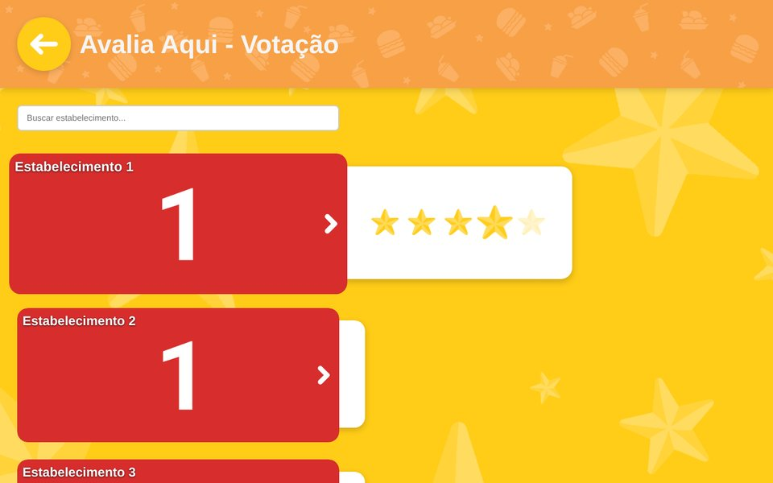
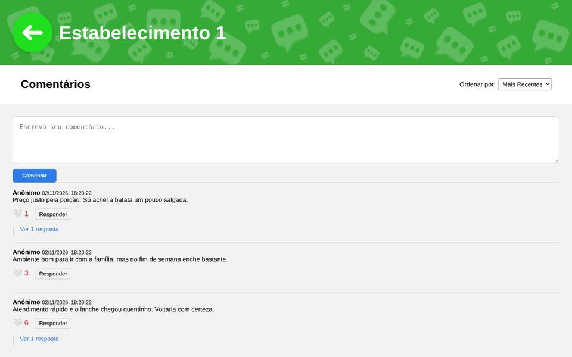
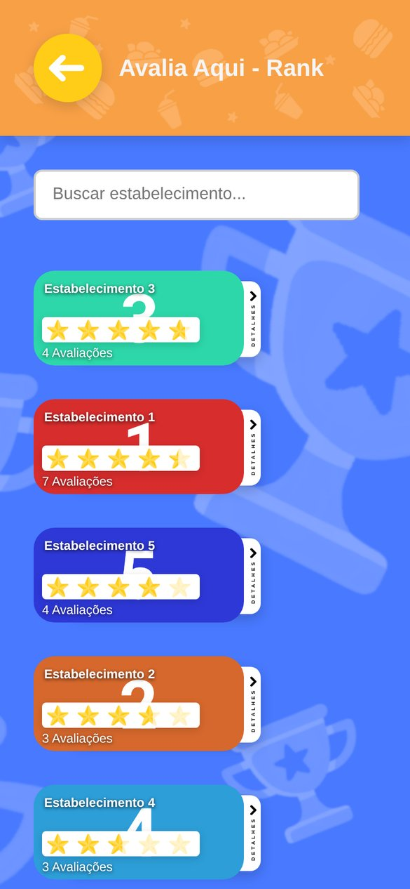
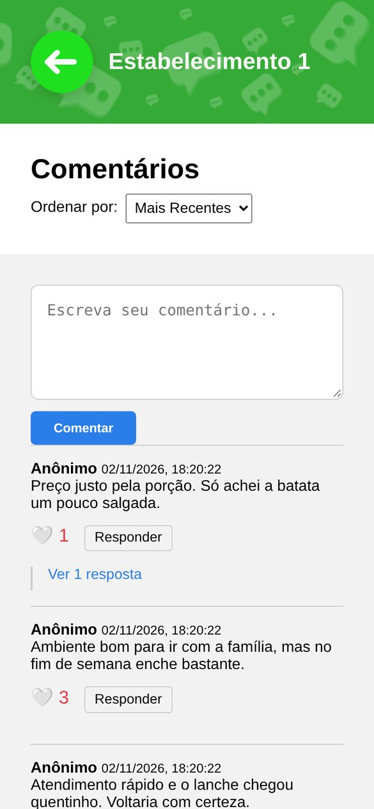

# Avalia Aqui

Website for rating local places, with a Node.js backend. Visitors vote with stars, see a ranking by average rating and leave anonymous comments with replies and likes. Votes and comments are stored in SQLite through a REST API built with Express and Sequelize.

**Live demo** (frontend only, data stays in the browser): [avalia-aqui.vercel.app](https://avalia-aqui.vercel.app), source in [PedroRossZny/avalia-aqui-demo](https://github.com/PedroRossZny/avalia-aqui-demo)

The interface is in Brazilian Portuguese.


## Screenshots

Captured from the app running locally, with sample votes and comments added through the API.

| Voting | Ranking | Comments |
|---|---|---|
|  |  |  |

| Ranking on a phone | Comments on a phone |
|---|---|
|  |  |

A GIF of the whole flow is in the [demo repository](https://github.com/PedroRossZny/avalia-aqui-demo#screenshots); the pages are the same.

## About

I built Avalia Aqui in September 2025 to practice a full-stack project without a framework on the frontend: a REST API with Express, a relational model with Sequelize (comments that reply to other comments) and a multi-page site in plain HTML, CSS and JavaScript. The visual design (logo, backgrounds and buttons) is my own.

In November 2026 I went back to the API and closed the gaps a public deployment would expose: votes and comments are now validated, each visitor has one vote per place, only the author can change a vote or delete a comment, and visitor IDs are no longer sent to other visitors.

## Features

- Star voting from 1 to 5 for each place. Voting again replaces the previous vote.
- Ranking ordered by average rating, with partly filled stars, the number of reviews and a details panel for each place.
- Search by name on the voting and ranking pages.
- Carousel for choosing which place to comment on.
- Anonymous comments with replies, likes and sorting by newest or most liked.
- Layout that adapts from desktop to phone.

## API

All routes are under `/api`. Error messages are in Portuguese, like the interface.

| Method | Route | Body or query | What it does |
|---|---|---|---|
| GET | `/reviews` | `placeId`, `anonId` (optional filters) | lists votes, newest first |
| POST | `/reviews` | `placeId`, `rating` (1 to 5), `anonId`, `comment` (optional) | adds a vote, or replaces this visitor's vote for the place |
| PUT | `/reviews/:id` | `rating`, `anonId` | changes a vote; only its author |
| GET | `/reviews/average/:placeId` | | returns `avgRating` and `count` |
| GET | `/comments` | `placeId`, `sortBy=curtidas` (optional) | returns the place's comments with their replies in `respostas`, newest first or most liked first |
| POST | `/comments` | `placeId`, `text` (1 to 1000 characters), `anonId`, `parentCommentId` (optional) | adds a comment, or a reply to a comment on the same place |
| POST | `/comments/:id/like` | | adds a like |
| DELETE | `/comments/:id/like` | | removes a like |
| DELETE | `/comments/:id` | `anonId` | deletes a comment and its replies; only its author |

Invalid input returns 400, a vote or comment that is not yours returns 403, and a missing one returns 404. Responses never include `anonId`.

## How it works

### Anonymous visitors

[`server/public/js/utils/anon.js`](server/public/js/utils/anon.js) creates a random ID with `crypto.randomUUID()` on the first visit and keeps it in `localStorage`. The browser sends it with every vote and comment, and the server uses it to keep one vote per visitor and place and to check authorship before a change or deletion. Because the API never returns it, one visitor cannot read another's ID from a listing.

### Data model

Two Sequelize models in [`server/models`](server/models): `Review` (`placeId`, `rating`, `comment`, `anonId`) and `Comment` (`placeId`, `text`, `anonId`, `parentCommentId`, `likeCount`). [`server/controllers/commentController.js`](server/controllers/commentController.js) loads a place's comments in one query and builds the reply tree in memory. `sequelize.sync()` creates the tables on the first start.

### Frontend

The pages in [`server/public`](server/public) are served by Express and call the API with `fetch`. The ranking draws each star twice, an empty one and a filled one on top, and cuts the filled one with `clip-path: inset()` to show averages like 4.5. Comment text is inserted with `textContent`, never as HTML, so markup in a comment is shown as plain text.

## Limitations

This is a study project, not a production service:

- The anonymous ID is not authentication. Clearing the site data gives a visitor a new ID and a new vote, and anyone with access to a visitor's browser can act as them.
- Likes are counted on the server without recording who liked. The browser remembers liked comments only for the current session, so the same visitor can like a comment again later.
- There is no rate limiting.
- The seven places are placeholders (Estabelecimento 1 to 7), with numbered images and placeholder descriptions.

## Tech stack

- Node.js with Express 4
- Sequelize 6 with SQLite (`sqlite3`)
- HTML5, CSS3 and JavaScript (ES modules), no frontend framework
- nodemon for development

## Project structure

```
.
├── package.json
└── server/
    ├── index.js                 # Express app: JSON API under /api and static files
    ├── utils/db.js              # Sequelize connection (database.sqlite)
    ├── models/                  # Review and Comment
    ├── controllers/             # validation and database access
    ├── routes/                  # /api/reviews and /api/comments
    └── public/                  # the website
        ├── index.html, vote.html, rank.html, carrossel.html
        ├── estabelecimento1-7.html
        ├── assets/              # logo, backgrounds, buttons, arrows, stars and place images
        ├── css/
        └── js/                  # one script per page, plus utils/anon.js
```

## Getting started

Requires Node.js 18 or newer.

```bash
git clone https://github.com/PedroRossZny/avalia-aqui.git
cd avalia-aqui
npm install
npm start
```

Open http://localhost:3000. The database is created as `database.sqlite` in the folder where the server starts, and it is ignored by Git.

| Script | What it does |
|---|---|
| `npm start` | starts the server |
| `npm run dev` | starts the server with nodemon, restarting on file changes |

The port defaults to 3000 and can be changed with the `PORT` environment variable, for example `PORT=8080 npm start`.

## License

The code is released under the [MIT License](LICENSE). The logo and the other images in `server/public/assets/` are not covered by it.

## Author

Pedro Ross. [GitHub](https://github.com/PedroRossZny) | [LinkedIn](https://www.linkedin.com/in/pedro-ross)
